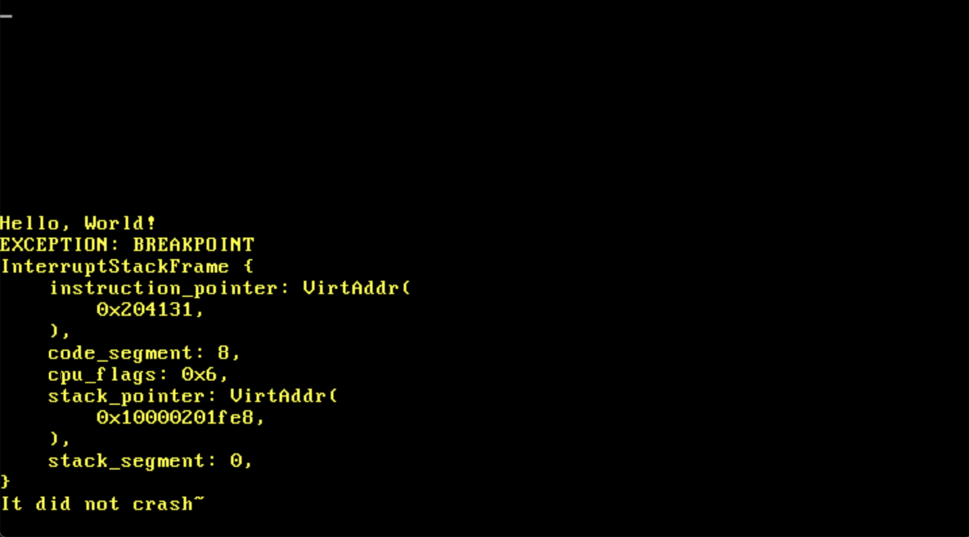

# Tellus



A 64-bit operating system written in Rust.

## Build

Ensure that you have `bootimage` installed. Installing it can be done with:

```sh
cargo install bootimage
```

After that, you may build the project with:

```sh
cargo bootimage
```

## Run

First, follow the prerequisites for building the project. After that, since this is an operating system, there are several ways to run the project. Perhaps the most convenient is to run it through QEMU. To do so, make sure to have QEMU installed and then run the project like any other Rust project with:

```sh
cargo run
```

## License

Tellus is distributed under the terms of the [MIT License](LICENSE-MIT) OR the [Apache License, Version 2.0](LICENSE-APACHE-2.0), at your option.
